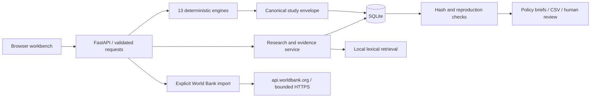

# Implemented architecture — GGISP v0.4

## Code boundaries

- `db.py`: original entities, single SQLite transaction manager, additive workbench schema initialization.
- `engines.py`: typed input schemas, bounded pure calculations, examples, model methods and limitations.
- `workbench.py`: engine catalog and sensitivity API; study persistence/reproduction; dataset normalization; source snapshots, exact evidence spans, review records, retrieval and brief sections.
- `connectors.py`: fixed-host on-demand World Bank adapter and normalization; no network on startup or during ordinary calculations.
- `main.py`: original project/evidence/recommendation/AI endpoints, lifespan, localhost Host checks and combined brief export.
- `lab.py` and `modelling.py`: original three-scenario debt lab and equation; nonfinite or numerically explosive trajectories rejected before execution.
- `workbench.html/.css/.js`: responsive, accessible labeled controls, schema-driven nested input forms, synthetic defaults, results tables/charts, evidence/data workbench, retrieval and saved-study review screen.

## New entities

`source_snapshots`: project, source, exact pasted/fetched text, SHA-256, UTC creation timestamp.

`evidence_spans`: claim and snapshot IDs, Unicode code-point offsets, exact quotation, researcher interpretation. Project IDs and claim/source correspondence are checked. Exact matching is not support verification.

`datasets`: project, source, normalized observations JSON and hash. CSV imports reject repeated series/year, inconsistent units, oversized rows, malformed columns and nonfinite values.

`analysis_runs`: project, engine ID, name, canonical payload and hash. Payload includes inputs, outputs, model version, assumptions note and content-addressed evidence references. Runs have no update/delete API. Reproduction compares the installed engine version and full output; stored content and reference hashes are checked separately.

`source_reviews`: source, personal review findings and UTC timestamp; recording a confirmed review updates the existing source review flag and preserves an audit event.

`analysis_reviews`: run ID, self-attested reviewer, needs-changes/reviewed-with-limits verdict, findings and timestamp. They never automatically approve recommendations or imply independent validation.

All write workflows record audit events in the same SQLite transaction. Timestamps use SQLite UTC. IDs link local records; hashes identify content. None is a digital signature or authenticated actor identity.

## API groups

- `GET /api/engines`: 13 methods, input JSON Schemas, examples and limitations.
- `POST /api/engines/{engine}/calculate`: calculate without persistence.
- `POST /api/engines/{engine}/sensitivity`: 2–15 values of one top-level numeric input.
- `POST /api/projects/{id}/analyses/{engine}`: save a versioned study and evidence references.
- `GET /api/projects/{id}/analyses`, `GET /api/analyses/{id}`: list and inspect runs, reference integrity and reviews.
- `POST /api/analyses/{id}/reproduce`: compare stored and current outputs, with content/version/reference checks.
- `GET /api/analyses/{id}/results.csv`: neutralized CSV in long form.
- `POST /api/analyses/{id}/reviews`: record confirmed human review.
- `POST/GET /api/projects/{id}/snapshots`, `GET .../snapshots/{id}`: preserve and inspect source text.
- `POST/GET /api/projects/{id}/evidence-spans`: exact claim-to-text links.
- `POST/GET /api/projects/{id}/datasets`, `GET .../datasets/{id}`: import and inspect normalized observations.
- `GET /api/projects/{id}/research-assistant?q=...`: local lexical retrieval and claim task list.
- `GET /api/connectors`, `POST /api/projects/{id}/imports/world-bank`: explicit connector catalog and import.
- Original projects, claims, recommendations, debt lab and brief APIs remain available.

All projects may save studies from different engines to support cross-domain research. This deliberately does not restrict a debt project to debt-only calculations.

## Validation and security boundary

Pydantic rejects unknown engine fields and nonfinite values. Collections and optimizer size are bounded. SQL references are parameterized and restricted to the same project. DOM text insertion and CSV formula neutralization reduce injection risk. External data access is restricted to one official HTTPS endpoint with no redirect following and a bounded response.

Localhost Host filtering is an incremental control, not authentication. This remains a local, single-user process without production identity, anti-abuse infrastructure, secure publication, encryption or independent review identity verification. The release builder excludes all SQLite databases, `.env`, runtime research, caches and old archives.

## Deployment progression

Before shared deployment: design an authenticated role model, organization isolation, record authorization, CSRF/session policy, rate limiting, migrations, encrypted backup/restore, automated browser tests and monitoring. Before scientific use: independently review each method, calibrate data and uncertainty, publish validation evidence and use domain experts. Before expanding generative AI: evaluate retrieval/citation accuracy and prompt injection with an explicit test corpus. These stages are not claimed complete by this release.
