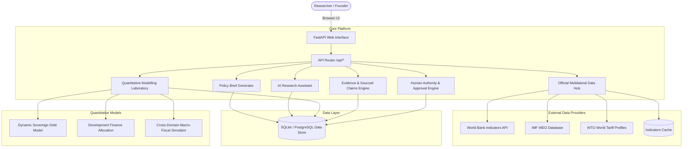

# GGISP Platform Architecture & Technical Blueprint (v0.2.0)

## 1. Executive Summary

The **Global Governance, Innovation & Solutions Platform (GGISP)** is an independent international policy research and advisory workspace combining mathematical models, official multilateral data, evidentiary provenance registers, and human-authored policy guidance.

The foundational design tenet of GGISP is **Human Authority over AI Output**:
- Founder recommendations are strictly human-authored and cannot be generated or approved by AI.
- AI drafting is segregated into separate working note records, clearly flagged with `AI-generated / unverified / not approved`.
- The Human Authority Approval Gate prevents advisory endorsement without at least one manually examined source and supported empirical claim.
- Cryptographic SHA-256 hashes seal evidence sources for audit integrity.

---

## 2. System Architecture

---

## 3. Thirteen Specialist Research Divisions

| Division | Family | Lead Reference Institution | Example Policy Application |
|---|---|---|---|
| **Nuclear Security** | High Security | IAEA / UN-ODA | Verification safeguards & non-proliferation monitoring |
| **UN Security Council** | Multilateral Policy | UN General Assembly | Veto reform analysis & peacebuilding mechanisms |
| **WTO and Global Trade** | Economic Policy | WTO / UNCTAD | Tariff shocks, supply chains & dispute resolution |
| **Global Sovereign Debt** | Economic Models | IMF / World Bank / Paris Club | Debt sustainability & restructuring frameworks |
| **AI Governance** | Technology Policy | NIST / ITU / OECD | Frontier safety covenents & algorithmic assurance |
| **Cybersecurity** | High Security | ITU / UN OEWG | Critical infrastructure defense & incident cooperation |
| **Global Health** | High Security | WHO / CEPI | Epidemiological intelligence & vaccine supply equity |
| **Space Security** | High Security | UNOOSA / COPUOS | Debris mitigation & peaceful outer space treaties |
| **Critical Minerals** | Economic / Supply | IEA / UNIDO | Chain-of-custody tracking & strategic value addition |
| **Ocean Governance** | Environmental Policy | UNCLOS / ISA | High Seas Treaty enforcement & marine protection |
| **International Taxation** | Economic Policy | OECD / UN Tax Committee | Global minimum tax & cross-border profit shifting |
| **Global Development Finance** | Economic Models | UNDP / MDBs | Concessional capital allocation & multiplier optimization |
| **Climate and Environmental Finance** | Environmental Policy | UNFCCC / GCF | Loss and damage funds & green capital mobilization |

---

## 4. Quantitative Models & Equations

### 4.1 Model 1: Dynamic Sovereign Debt Sustainability Model
$$d_{t+1} = \frac{1 + i_t}{1 + g_t} d_t - pb_t + \alpha \cdot \Delta e_t \cdot d^{ext}_t + \epsilon_t$$
- $d_t$: Public Debt / GDP ratio (%)
- $i_t$: Effective nominal interest rate (%)
- $g_t$: Nominal GDP growth rate (%)
- $pb_t$: Primary budget balance (% of GDP)
- $\alpha \cdot \Delta e_t \cdot d^{ext}_t$: Currency depreciation valuation shock on foreign-currency debt
- $\epsilon_t$: Contingent liabilities realization shock

Stabilizing primary balance:
$$pb^* = d_t \cdot \frac{i - g}{1 + g}$$

### 4.2 Model 2: Development Finance Allocation Engine
Optimizes total concessional capital pool $B_{total}$ across:
- Infrastructure ($M_{infra} = 1.45x$)
- Healthcare ($M_{health} = 1.25x$)
- Education ($M_{edu} = 1.35x$)
- Climate Adaptation ($M_{climate} = 1.18x$)

Monitors revenue absorption ceiling:
$$\text{Absorption Ratio} = \frac{\text{Existing Debt Service} + \text{New Concessional Service}}{\text{Annual Government Revenue}} \times 100$$
Threshold: $>20\%$ indicates severe fiscal stress.

### 4.3 Model 3: Validated Cross-Domain Macro-Fiscal Simulator
Couples WTO trade tariff shocks with sovereign debt paths and multilateral development financing:
1. Partner tariff shock $\Delta \tau$ reduces export volume:
   $$\Delta \text{Export Volume} \% = \epsilon_{price} \times \frac{\Delta \tau}{1 + \tau_0}$$
2. Export decline creates foreign-exchange shortage and fiscal customs revenue drag.
3. Compares 3 distinct policy paths:
   - **Path 1:** Orthodox Fiscal Austerity (sharp reduction in health/climate spending)
   - **Path 2:** Uncoordinated Debt Haircut (loss of market access)
   - **Path 3:** GGISP Multilateral Accord (debt reprofiling + tariff standstill + concessional financing)

---

## 5. Security & NIST AI Risk Management Framework Compliance

- **MAP (Context & Risks):** Clearly identifies that AI working notes are untrusted assistance, isolated from founder-authored guidance.
- **MEASURE (Assurance & Verification):** Strict Human Authority gate blocks recommendation approvals until at least one manually examined source and supported claim is cataloged.
- **MANAGE (Containment & Safeguards):** Explicit consent modal required before transmitting project data to external LLMs; prompt injection protection treats all user entries as untrusted data.
- **GOVERN (Audit Provenance):** Every source entry computes an automated cryptographic SHA-256 hash snapshot, and all approvals write permanent entries to `audit_log`.
